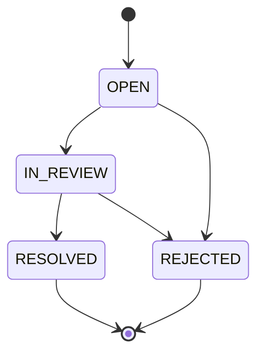

# Admin service

`services/admin-service`, port 4011, database `admin_db` (local port 5411). Owner: Huy.

Last verified: 2026-11-06, branch `fix/sprint-4-followups-v2` (on top of main `67c16a9`).

Health monitoring of all services (#58), account reports (#59), master ingredient catalog (#48) and recommendation weights (#49), with an audit log.

The mobile admin dashboard ("Tổng quan", see the [admin screens README](../apps/mobile/src/screens/admin/README.md)) reads `GET /health-monitor/status`, `/health-monitor/summary`, `/health-monitor/timeseries` and `GET /reports/stats?window=`.

## Access control

The service trusts `x-user-id` and `x-user-role`, which only the gateway sets from a verified JWT (see [gateway.md](gateway.md)).

- `requireAdmin`: `x-user-role` must be `ADMIN`, otherwise `403 FORBIDDEN`.
- `requireUser`: `x-user-id` must be present, otherwise `401 UNAUTHORIZED`.

## API

Paths are as seen by the service; through the gateway prefix them with `/api/admin`.

### Health monitor (#58), all `requireAdmin`

| Method and path | Purpose |
|---|---|
| `GET /health-monitor/status` | Latest status per service + `overall` |
| `GET /health-monitor/history?service=&from=&to=&page=&limit=` | Raw samples (`limit` max 200, default 50) |
| `GET /health-monitor/summary?window=24h\|7d` | Per service: uptime %, average and p95 response time, last status; `overall` |
| `GET /health-monitor/timeseries?service=&window=24h\|7d` | Bucketed uptime %, average and p95 response time (admin dashboard charts) |
| `POST /health-monitor/check-now` | Run one poll immediately and return the result |

`GET /health-monitor/timeseries`:
- `window` defaults to `24h`: buckets of 1 hour. `7d`: buckets of 6 hours. Bucket edges are aligned to the UTC epoch (full hours / 00, 06, 12, 18 UTC), so they stay stable between refreshes. The range covers the whole summary window `[now − window, now]`: the start is rounded down and the end up to a bucket edge, which gives 25 hourly / 29 six-hour buckets (24 / 28 when `now` is exactly on an edge). Every sample counted by `/summary` therefore lands in a bucket.
- `service` is optional and must be one of the monitored services (otherwise `400 VALIDATION_ERROR`, "Unknown service"). Without it, every monitored service's samples are combined.
- Each bucket uses the same math as the summary: `{ start, end, samples, uptimePercent, avgResponseTimeMs, p95ResponseTimeMs }`. Buckets without samples are returned with `samples: 0` and `null` values, so charts can show gaps.
- Response: `{ service | null, window, bucketMinutes, from, to, buckets }`.

- Targets: the 11 services and the gateway (`*_SERVICE_URL`, `GATEWAY_URL`), probed on `/health` every `HEALTH_POLL_INTERVAL_SECONDS` with a `HEALTH_CHECK_TIMEOUT_MS` timeout.
- Classification: no response or non-2xx → `DOWN`; 2xx with body `status: DEGRADED` or slower than `HEALTH_DEGRADED_THRESHOLD_MS` → `DEGRADED`; otherwise `UP`.
- `overall`: `UNKNOWN` before any sample; `UP` only when every service has a sample and all are `UP`; `DOWN` when all are `DOWN`; otherwise `DEGRADED` (a service without samples keeps the overall from being `UP`).
- Uptime counts every non-`DOWN` sample as available; p95 uses the nearest-rank method.
- An audit row (`SERVICE_STATUS_CHANGED`, actor `system`) is written only when a service crosses the `DOWN` boundary (goes down or recovers), not on every poll.
- A daily retention job deletes samples older than `HEALTH_LOG_RETENTION_DAYS`.

### Account reports (#59)

| Method and path | Guard | Purpose |
|---|---|---|
| `POST /reports` | `requireUser` | `{ category: ABUSE\|SPAM\|BUG\|OTHER, description (10–2000), reportedUserId? }`; cannot report yourself |
| `GET /reports/mine?page=&limit=` | `requireUser` | Own reports (the handling admin's id is hidden) |
| `GET /reports?status=&category=&sort=&page=&limit=` | `requireAdmin` | All reports; `sort` is `createdAt:desc` (default), `createdAt:asc`, `updatedAt:desc` or `updatedAt:asc` |
| `GET /reports/stats?window=24h\|7d` | `requireAdmin` | Counts per status and category. With the optional `window`, also `window` and `resolvedInWindow` (reports with status `RESOLVED` and `resolvedAt` inside the window); without it the response is unchanged |
| `GET /reports/:id` | `requireAdmin` | One report |
| `PATCH /reports/:id/status` | `requireAdmin` | `{ status, resolutionNote? }` |

- `resolutionNote` is required for `RESOLVED` and `REJECTED`.
- A disallowed transition gives `409 INVALID_TRANSITION` with `details.allowed`. A concurrent change (optimistic `updateMany` on the expected status) gives `409 CONFLICT`. The status change and its audit row (`REPORT_STATUS_CHANGED`) are written in one transaction.
- On `RESOLVED` / `REJECTED` the reporter gets an in-app notification through notification-service `POST /internal/notifications` (`INTERNAL_API_KEY`, `NOTIFY_TIMEOUT_MS`, one retry). This is best effort and outside the transaction: the response field `notification` is `sent`, `failed` or `skipped`, and a failure never undoes the resolution.
- A user may file at most `REPORT_RATE_LIMIT_PER_HOUR` reports per rolling hour (`429 RATE_LIMITED`).

### Master ingredients (#48), `requireAdmin`

`GET /ingredients` (search, active filter, paging), `GET /ingredients/export`, `GET /ingredients/:id`, `POST /ingredients`, `PUT /ingredients/:id`, `PATCH /ingredients/:id/active` (soft delete), `POST /ingredients/import` (max 500). Names are unique after accent/case normalization (`409 CONFLICT` on duplicates). Every change writes an audit row.

### Recommendation weights (#49)

`GET /weights/effective` is readable without the admin role (used by other services). Admin only: `GET /weights`, `GET /weights/:key`, `GET /weights/:key/history`, `PUT /weights/:key` (`{ value 0–1, expectedVersion }`, `409 CONFLICT` when the version is stale), `POST /weights/reset-defaults`. Values are not normalized. Run `pnpm --filter admin-service prisma:seed` once after migrating.

## Errors

`{ error, message, details? }`, never a stack trace: `400 VALIDATION_ERROR`, `401 UNAUTHORIZED`, `403 FORBIDDEN`, `404 NOT_FOUND`, `409 CONFLICT` / `INVALID_TRANSITION`, `429 RATE_LIMITED`, `503 DATABASE_UNAVAILABLE` (database unreachable, connection dropped or timed out, pool exhausted, or table missing: Prisma P1001, P1002, P1008, P1017, P2021, P2024 and initialization errors; the service keeps running and recovers when the database is back), `500 INTERNAL_ERROR`.

## Environment

| Variable | Default | Purpose |
|---|---|---|
| `PORT` | 4011 | Listen port |
| `DATABASE_URL` | local 5411 | Postgres connection string |
| `ENABLE_JOBS` | true | Health poller + retention; enable on **one** instance only |
| `HEALTH_POLL_INTERVAL_SECONDS` | 60 | Poll interval |
| `HEALTH_CHECK_TIMEOUT_MS` | 2000 | Per-probe timeout |
| `HEALTH_DEGRADED_THRESHOLD_MS` | 1000 | Slower than this → `DEGRADED` |
| `HEALTH_LOG_RETENTION_DAYS` | 14 | Sample retention |
| `<NAME>_SERVICE_URL`, `GATEWAY_URL` | `http://localhost:40xx` | Health targets (bare `host:port` accepted) |
| `REPORT_RATE_LIMIT_PER_HOUR` | 5 | Reports per user per hour |
| `INTERNAL_API_KEY` | — | Must equal notification-service's |
| `NOTIFY_TIMEOUT_MS` | 2000 | Timeout for the reporter notification |

## Database

Tables: `master_ingredients`, `recommendation_weights`, `recommendation_weight_history`, `service_health_logs`, `account_reports`, `audit_logs`. Prisma 5.22.0 with a dedicated client output; the image runs `prisma migrate deploy` on start.

## Tests

`pnpm --filter admin-service test` (141 tests, 98.71 % line coverage at the last run).
