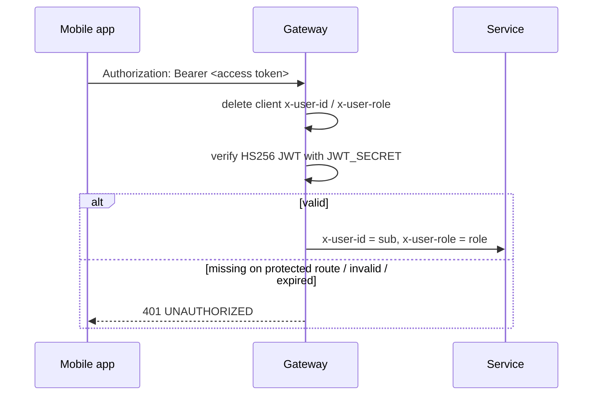

# API gateway

`apps/gateway`, port 4000. The only entry point for clients (mobile app, web, smoke scripts). Owner: Huy.

Last verified: 2026-11-04, commit `d792648`.

## Routing

The gateway strips the `/api/<prefix>` segment and forwards the rest: `GET /api/notifications/promotions` becomes `GET /promotions` at notification-service.

| Prefix | Service | Port (local) |
|---|---|---|
| `/api/auth` | auth-service | 4001 |
| `/api/families` | family-service | 4002 |
| `/api/inventory` | inventory-service | 4003 |
| `/api/nutrition` | nutrition-service | 4004 |
| `/api/meal-diary` | meal-diary-service | 4005 |
| `/api/recipes` | recipe-service | 4006 |
| `/api/menus` | menu-service | 4007 |
| `/api/shopping-list` | shopping-list-service | 4008 |
| `/api/payments` | payment-service | 4009 |
| `/api/notifications` | notification-service | 4010 |
| `/api/admin` | admin-service | 4011 |

- `GET /health` reports the gateway itself; `GET /api/health` aggregates every service.
- `/api/<prefix>/internal/*` always answers `404 ROUTE_NOT_FOUND`: internal endpoints are reachable only inside the private network.
- An unknown prefix answers `404 ROUTE_NOT_FOUND`; an unreachable service answers `503 SERVICE_UNAVAILABLE`.
- Service URLs may be full URLs (`http://auth-service:4001`) or bare `host:port` (Render private networking); `http://` is added when the scheme is missing.

## Authentication and header trust model

1. For every request the gateway **deletes** client-supplied `x-user-id` and `x-user-role`, so a client cannot claim an identity.
2. With a `Bearer` token, it verifies the JWT (HS256, `JWT_SECRET`, the same secret auth-service signs with). It sets `x-user-id` from `sub` and `x-user-role` from `role` (only `USER` or `ADMIN`).
3. An invalid or expired token gets `401 UNAUTHORIZED` ("Invalid access token" / "Access token expired").
4. No token: the request is forwarded without identity headers, and the service decides (for example admin-service answers 401/403).
5. Exempt from token checks: `/health`, `/api/health`, `/api/auth` and `/api/auth/*`.
6. With `NODE_ENV=production` and no `JWT_SECRET`, the gateway refuses to start (fails closed). Outside production a dev fallback is used so local tests work.

Services trust `x-user-id` / `x-user-role` **only because** they are reachable solely through the gateway (compose network / Render private services). Never publish a service port in production.

## Rate limiting and caching

- `/api/*`: `RATE_LIMIT_MAX` requests per `RATE_LIMIT_WINDOW_MS` per IP; `/api/auth`: the stricter `AUTH_RATE_LIMIT_MAX`. Over the limit: `429 { "error": "RATE_LIMITED", "retryAfterSeconds": n }` plus `RateLimit-*` headers.
- Public `GET /api/recipes/health` and `GET /api/notifications/promotions` are cached in memory (`CACHE_TTL_SECONDS`, `CACHE_MAX_ITEMS`). The `x-cache` header is `MISS`, `HIT` or `BYPASS` (authenticated requests and non-GET methods bypass).
- Behind a proxy (Render), set `TRUST_PROXY=true` so the client IP is taken from `X-Forwarded-For`.
- Every response carries `x-request-id` (kept from the request or generated).

## Errors

Gateway-generated errors are JSON: `{ "error": "<CODE>", ... }`.

| Status | `error` | When |
|---|---|---|
| 401 | `UNAUTHORIZED` | Invalid or expired Bearer token |
| 404 | `ROUTE_NOT_FOUND` | Unknown prefix or `/internal/*` path |
| 429 | `RATE_LIMITED` | Rate limit exceeded |
| 503 | `SERVICE_UNAVAILABLE` | Target service unreachable |

## Environment

| Variable | Default | Purpose |
|---|---|---|
| `PORT` | 4000 | Listen port |
| `JWT_SECRET` | — (required in production) | HS256 secret, must equal auth-service's |
| `<NAME>_SERVICE_URL` | `http://localhost:40xx` | One per service (see `apps/gateway/.env.example`) |
| `CORS_ORIGINS` | `*` | Allowed origins, comma separated |
| `RATE_LIMIT_WINDOW_MS` / `RATE_LIMIT_MAX` / `AUTH_RATE_LIMIT_MAX` | 60000 / 100 / 20 | Rate limits |
| `CACHE_TTL_SECONDS` / `CACHE_MAX_ITEMS` | 30 / 100 | Response cache |
| `TRUST_PROXY` | false | Trust `X-Forwarded-For` |

## Tests

`pnpm --filter gateway test` (Vitest + supertest, 42 tests, 98.59 % line coverage at the last run, including a check that per-user notification routes are never served from the cache). Live checks: `pnpm test:routing`, `pnpm test:e2e-smoke`.
