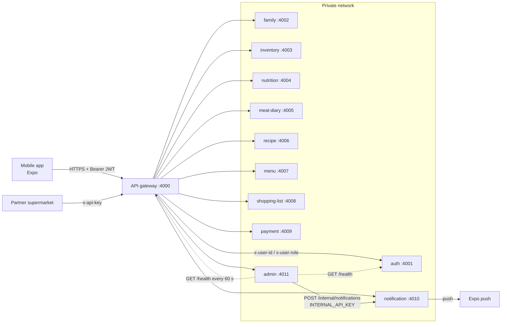

# Infrastructure

Owner: Huy. Last verified: 2026-11-06, branch `fix/sprint-4-followups-v2` (on top of main `ac3f750`).

## Architecture



Each service owns one PostgreSQL 16 database; no service reads another's database. Services talk to each other only over HTTP inside the private network.

## Ports and databases (docker compose project `smartkitchen`)

| Service | Port | Database | DB host port | Owner |
|---|---|---|---|---|
| gateway | 4000 | — | — | Huy |
| auth-service | 4001 | `auth_db` | 5401 | Kazan |
| family-service | 4002 | `family_db` | 5402 | Kazan |
| inventory-service | 4003 | `inventory_db` | 5403 | Khanh |
| nutrition-service | 4004 | `nutrition_db` | 5404 | Hung |
| meal-diary-service | 4005 | `meal_diary_db` | 5405 | Hung |
| recipe-service | 4006 | `recipe_db` | 5406 | Cuong |
| menu-service | 4007 | `menu_db` | 5407 | Cuong |
| shopping-list-service | 4008 | `shopping_list_db` | 5408 | Khanh |
| payment-service | 4009 | `payment_db` | 5409 | Cuong |
| notification-service | 4010 | `notification_db` | 5410 | Huy |
| admin-service | 4011 | `admin_db` | 5411 | Huy |

Local database credentials are `postgres` / `postgres` (local only). Host ports are published for development; in production only the gateway is public.

## Local setup

1. Node 20 (service images and CI), pnpm 9.15.4, Docker Desktop. `pnpm install` at the root. To run the mobile app locally use Node 22.13 or newer: Expo SDK 58 declares `^22.13.0 || ^24.3.0 || ^26.0.0 || >=27.0.0`, and the Expo CLI warns on older versions.
2. Copy the root env file and set a secret **before** starting compose:
   ```powershell
   Copy-Item .env.example .env        # bash: cp .env.example .env
   # Generate 64 hex characters and paste them as JWT_SECRET in .env:
   -join (1..64 | % { [char]((48..57)+(97..102) | Get-Random) })   # bash: openssl rand -hex 32
   ```
   The root `.env` is required: compose refuses to start without `JWT_SECRET` and `PURCHASE_SYNC_API_KEY` (replace both placeholders from `.env.example`). `.env` is git-ignored; never commit it.
3. `docker compose -p smartkitchen up -d --build`
4. Check: `pnpm test:health` (12 endpoints), `pnpm test:routing`, `pnpm test:e2e-smoke`. The e2e smoke scripts sign a dev token with `JWT_SECRET`: from the environment if set, otherwise from the root `.env` (only that key is parsed, never printed). Without either they fail with "copy .env.example to .env and set JWT_SECRET". `pnpm test:prod-smoke` does not need `JWT_SECRET`.

Notification and admin images run `prisma migrate deploy` on start. Seed admin data once: `pnpm --filter admin-service prisma:seed` with `DATABASE_URL` pointing at port 5411.

### Startup order and healthchecks

- Every service and the gateway have a healthcheck on `http://127.0.0.1:<port>/health`. Use `127.0.0.1`, not `localhost`, which can resolve to IPv6 `::1` in Alpine.
- Each service waits for its own database (`service_healthy`). inventory-service also waits for family-service; shopping-list-service also waits for family-service, inventory-service and menu-service; admin-service also waits for auth-service and family-service.
- The gateway has no `depends_on`: it starts on its own, whatever the state of the backend. A service that is stopped, unhealthy or not started yet answers `503 SERVICE_UNAVAILABLE` on its routes, and `/api/health` reports `DEGRADED`. Right after a fresh `up` this is normal until all services are up; use `up -d --wait` to wait for them.
- `docker compose up gateway` now starts only the gateway. Use plain `up`, or name the services you want.
- If family-service never becomes healthy on a fresh `up`, compose exits with `dependency failed to start`. The gateway and the services that don't depend on it keep running; inventory-service, shopping-list-service and admin-service stay `created`. In that state `/api/health` can also list healthy services as `DOWN` (seen with payment-service and notification-service), so check `docker compose ps` and the service's own route. Fix that service and run `up` again.

## Scripts and CI

| Command | What it does |
|---|---|
| `pnpm lint` / `pnpm build` / `pnpm test` | Turbo across all workspaces |
| `pnpm test:coverage` | Vitest coverage (v8) for gateway, notification, admin |
| `pnpm check:infra` | Repo consistency: ports, compose, Dockerfiles, env examples, BOM, Prisma rules. Also fails on a `localhost` healthcheck or any gateway `depends_on`. `FAIL` for infra-owned problems, `WARN` for other owners' files |
| `pnpm test:health` / `test:routing` | Live health and routing checks |
| `pnpm test:e2e-smoke` (`:bash`) | E2E smoke through the gateway |
| `pnpm test:prod-smoke` (`:bash`) | Smoke against a deployed gateway (`BASE_URL`) |

`.github/workflows/ci.yml` runs on PRs to `main`/`develop` and pushes to `main`: a matrix per workspace (frozen install, Prisma generate, lint, build, tests with coverage where available), a `mobile-typecheck` job, an `infra-check` job, and the aggregate `ci-success`, which is the required status check.

## Troubleshooting

| Symptom | Cause | Fix |
|---|---|---|
| `port is already allocated` / `EADDRINUSE` | Another process or an old stack uses 40xx/54xx | `docker compose -p smartkitchen down`; find the process with `netstat -ano \| findstr :4000` (or `lsof -i :4000`) and stop it if it is yours |
| `503 DATABASE_UNAVAILABLE`, logs show `P2021` (table does not exist) | Migrations not applied | Rebuild/restart the service (images migrate on start) or run `pnpm --filter <service> prisma:deploy` with its `DATABASE_URL` |
| `503 DATABASE_UNAVAILABLE`, logs show `P1001` / `P1017` / `P2024` | Database container down or restarting (`P1017`: connections in the pool were closed) | `docker compose -p smartkitchen up -d <name>-db`; the service keeps running and recovers by itself |
| `429 RATE_LIMITED` during tests | Gateway limiter (100/min, auth 20/min) | Wait `retryAfterSeconds`, or raise `RATE_LIMIT_MAX` locally |
| `401 UNAUTHORIZED` from the gateway with a valid-looking token | Gateway and auth-service use different `JWT_SECRET` | Set the same value in `.env` and recreate both containers |
| E2E smoke: authenticated checks fail with `401` | A `JWT_SECRET` in your shell (it wins over `.env`) differs from the one the stack runs with | Unset it (`Remove-Item Env:JWT_SECRET` / `unset JWT_SECRET`) so the script reads `.env`, or recreate the stack from `.env` |
| `bash: not found` / WSL error when running `pnpm test:*:bash` from PowerShell | `bash` resolves to WSL, which is not installed | Run the `.sh` scripts from Git Bash, or use the PowerShell variants |
| `docker compose up` exits with `dependency failed to start: ... is unhealthy`, some services stay `created` | A service others wait for is unhealthy (see Startup order and healthchecks). The gateway still runs, and `/api/health` reports `DEGRADED` | `docker compose -p smartkitchen ps`, check that service's logs, fix it and run `up` again |
| Metro: `Unable to resolve "invariant"` when bundling the mobile app | `metro.config.js` disabled hierarchical lookup under pnpm's isolated layout | Fixed on main (PR #13): update your branch and run `pnpm install` |
| Prisma client errors after switching branches | Stale generated client | `pnpm turbo run build --filter=<service>` (generates the client first) |

## Runbook

### Rotate `JWT_SECRET`

1. Generate a new value (command above). Never write it into a committed file or a report.
2. Update it in `.env` (local; compose passes it to auth-service, family-service, inventory-service, shopping-list-service and the gateway) or the Render env group `smartkitchen-jwt` (production). Every service using it must change at the same time.
3. Restart those services. All existing access tokens become invalid, and users sign in again.

### Rotate `INTERNAL_API_KEY` / `PARTNER_API_KEY`

Update `INTERNAL_API_KEY` (Render env group `smartkitchen-internal`) for notification-service **and** admin-service together, then restart both; reporter notifications fail (`notification: "failed"`) only during the gap. For `PARTNER_API_KEY`, give partners the new key first, then change it on notification-service.

### Add a new Prisma service (checklist)

- [ ] `prisma` and `@prisma/client` pinned to `5.22.0`.
- [ ] A dedicated generator `output` (e.g. `../node_modules/.prisma/client-<name>`, as admin-service does), and imports from that path, never from `@prisma/client` (pnpm shares one `@prisma/client` between services).
- [ ] Scripts: `prisma:generate`, `prisma:deploy`, `prisma:migrate`. Do **not** put `prisma generate` inside `build` (turbo runs `prisma:generate` before `build`).
- [ ] Commit migrations; schema changes only through new migrations. No `migrate dev` / `db push` outside development.
- [ ] Dockerfile: `node:20-alpine`, multi-stage, `NODE_ENV=production`, `USER node`, `CMD npx --no-install prisma migrate deploy && npm start`.
- [ ] Compose: its own database with a `pg_isready` healthcheck; the service `depends_on` it with `service_healthy`; a service healthcheck on `http://127.0.0.1:<port>/health` (never `localhost`).
- [ ] `.env.example` with placeholders only; fill in `prisma_schema` in the `ci.yml` matrix.
- [ ] `pnpm check:infra` passes.
