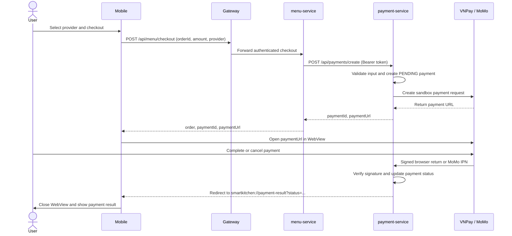

# Sprint 4: Recipe, Menu and Payment

## Architecture overview

The mobile app presents the recipe catalog, meal plan and payment WebView. Mobile API requests use the configured API gateway (`EXPO_PUBLIC_API_BASE_URL`, default port `4000`); the gateway is responsible for authenticating the user and forwarding trusted identity headers to services that use them.

```text
Mobile app
  ├─ GET /api/recipes ───────────────────> recipe-service (default port 4006)
  ├─ /api/menu/* ─────────────────────────> menu-service (default port 4007)
  │                                            ├─ reads recipe catalog from recipe-service
  │                                            └─ POST /api/payments/create ──> payment-service (default port 4009)
  └─ opens paymentUrl in PaymentScreen WebView
                                               ├─ VNPay browser return ───────> payment-service callback
                                               └─ MoMo server IPN ────────────> payment-service callback
```

Each service owns its Prisma schema and database access. Menu and payment records refer to IDs from other services; they do not declare cross-database Prisma relations. Payment callbacks validate provider signatures before updating a pending payment.

The current checkout button in the mobile menu uses the Sprint 3 development fixture (`mock-order-123`, `50,000 VND`). It is for sandbox integration only: the production order service must create and price the order server-side before enabling real payments.

## API endpoints

Unless noted otherwise, successful JSON endpoints return the objects shown below. Validation errors return `400` with `{ "error": "Invalid request", "details": [...] }`; unexpected service errors return `500` with `{ "error": "Internal server error" }`.

### Recipe service

Base path: `/api/recipes`. Read access is available to the mobile catalog. Create, update and delete require an authenticated administrator; the gateway verifies the bearer token and forwards the trusted `x-user-role` header.

| Method and path | Request | Success response |
|---|---|---|
| `GET /api/recipes` | Optional query: `?search=rice&mealType=lunch` | `[{ "id": "recipe-1", "name": "Vegetable rice", "ingredients": ["rice", "spinach"], "mealTypes": ["lunch"], "dietaryTags": ["vegetarian"], "tags": [], "preparationMinutes": 25, "servings": 2, "createdAt": "...", "updatedAt": "..." }]` |
| `GET /api/recipes/:id` | — | One recipe object, or `404 { "error": "Recipe not found" }` |
| `POST /api/recipes` (admin) | `{ "name": "Vegetable rice", "description": "Quick lunch", "ingredients": ["rice", "spinach"], "mealTypes": ["lunch"], "dietaryTags": ["vegetarian"], "tags": ["quick"], "preparationMinutes": 25, "servings": 2 }` | `201` and the created recipe object |
| `PUT /api/recipes/:id` (admin) | Any non-empty subset of the create fields | Updated recipe object |
| `DELETE /api/recipes/:id` (admin) | — | `204` with no body |

### Menu service

Base path: `/api/menu`. User-specific endpoints expect the authenticated identity header `x-user-id`, normally supplied by the gateway.

| Method and path | Request | Success response |
|---|---|---|
| `GET /api/menu` | `x-user-id` header | Array of menus with `items` |
| `POST /api/menu` | `{ "title": "Weekly plan", "periodType": "WEEK", "startDate": "2026-11-02", "endDate": "2026-11-08", "items": [{ "dishName": "Vegetable rice", "mealType": "LUNCH", "dayOfWeek": 1, "calories": 520 }] }` | `201` and the created menu with items |
| `GET /api/menu/:id` | `x-user-id` header | One menu with items; `404` when it does not belong to the user or does not exist |
| `DELETE /api/menu/:id` | `x-user-id` header | `204`; `404` when the menu does not belong to the user or does not exist |
| `POST /api/menu/generate` | `{ "periodType": "DAY", "startDate": "2026-11-02", "endDate": "2026-11-02", "preferences": {}, "constraints": {} }` | `201` and the generated menu with items |
| `POST /api/menu/auto-refresh` | `{ "inventoryItems": [{ "name": "spinach" }] }` | `{ "scannedMenus": 1, "replacements": [{ "menuId": "...", "menuItemId": "...", "fromRecipeId": "...", "toRecipeId": "..." }] }` |
| `POST /api/menu/checkout` | `{ "orderId": "mock-order-123", "amount": 50000, "provider": "VNPAY" }` | `201 { "order": { "id": "mock-order-123" }, "paymentId": "...", "paymentUrl": "https://..." }` |

Supported `periodType` values are `DAY`, `WEEK`, and `MONTH`; supported meal types are `BREAKFAST`, `LUNCH`, `DINNER`, and `SNACK`. Checkout forwards the request's bearer token to payment-service.

### Payment service

Base path: `/api/payments`. Create and status endpoints require a valid bearer token; callbacks are provider-facing and validated using provider signatures.

| Method and path | Request | Success response |
|---|---|---|
| `POST /api/payments/create` | `{ "orderId": "mock-order-123", "amount": 50000, "provider": "VNPAY" }` | `201 { "paymentId": "...", "orderId": "mock-order-123", "amount": 50000, "currency": "VND", "status": "PENDING", "paymentUrl": "https://..." }` |
| `GET /api/payments/:id/status` | Bearer token | Payment status object for the authenticated user; `404` if it is not found |
| `GET /api/payments/callback` | Provider query parameters (`vnp_*` or MoMo redirect parameters) | `302` redirect to `smartkitchen://payment-result?status=success|failed&paymentId=...` |
| `POST /api/payments/callback/momo` | MoMo IPN callback JSON | `{ "resultCode": 0, "message": "Success", "paymentId": "...", "status": "SUCCESS" }` |

`provider` is `VNPAY` or `MOMO`; payment statuses are `PENDING`, `SUCCESS`, `FAILED`, and `REFUNDED`. Provider credentials and callback URLs are configured only on the payment service.

## Payment flow



VNPay reports its result through the signed `GET /api/payments/callback` return. MoMo uses its signed server-to-server IPN at `POST /api/payments/callback/momo` and can also send the user back through the browser callback. A callback changes only a pending payment; the mobile deep link is a presentation signal, while the payment status endpoint remains the source of truth.

## Verification

The service tests use Node's built-in test runner and mocked Prisma/provider dependencies:

```sh
pnpm --filter recipe-service test
pnpm --filter menu-service test
pnpm --filter payment-service test
pnpm turbo run typecheck
pnpm turbo run lint
```
